# headerguard

**Grade a website's HTTP security posture from a single request, then write the fix.** Security headers, CSP quality, cookie flags, TLS, and what the page itself loads (third-party scripts without integrity, mixed content, forms posting over HTTP) come out as one letter grade. `--fix nginx|apache|caddy|headers` prints the missing headers as config to paste, with a Content-Security-Policy built from the page: every origin it loads from and a SHA-256 hash for every inline script. Checked in real Chrome on 19 live sites. Zero dependencies.

[](https://github.com/njuj/headerguard/actions/workflows/ci.yml)


<p align="center"></p>

<p align="center"></p>

```text
$ headerguard github.com

 headerguard v0.2.0  →  https://github.com  200 · TLSv1.3 · cert 68d

   GRADE   A    93/100

   ✔ HTTPS                       served over HTTPS
   ✔ TLS                         TLSv1.3, certificate valid for 68 more days (Sectigo Limited)
   ✔ Strict-Transport-Security   max-age 31536000, preload
   ✔ Content-Security-Policy     strict policy, 15 directives
   ✔ Clickjacking                CSP frame-ancestors 'none'
   ✔ X-Content-Type-Options      nosniff
   ✔ Referrer-Policy             strict-origin-when-cross-origin
   ⚠ Permissions-Policy          missing: camera, mic, geolocation etc. not restricted  -3
   · Cross-Origin-Opener-Policy  not set (needed for cross-origin isolation)
   ⚠ Cookies                     _octo without HttpOnly  -2
   ✔ Version disclosure          no version banners
   ⚠ Subresource Integrity       64 third-party file(s) without integrity= from github.githubassets.com  -2
   ✔ Mixed content               every resource over https://
   ✔ Forms                       2 form(s), all submit over https://
```

## What it checks

| Check | Pass | Penalty |
|---|---|---|
| **HTTPS** | final URL is `https://` (http → https redirects are detected) | plain HTTP: **-30, grade capped at F** |
| **TLS** | TLS 1.2+, certificate verifies, more than 14 days left | rejected/expired cert or TLS ≤ 1.1: **F** · expiring soon: -8 |
| **HSTS** | `max-age` ≥ 180 days + `includeSubDomains` | missing -15 · short -8 · no subdomains -3 |
| **CSP** | scripts locked down, `object-src 'none'`, `base-uri` set | missing -20 · report-only -15 · `unsafe-inline` without nonce/hash -10 · `unsafe-eval` -5 · wildcard sources -8 *(max -18)* |
| **Clickjacking** | `frame-ancestors` or `X-Frame-Options: DENY/SAMEORIGIN` | -10 |
| **MIME sniffing** | `X-Content-Type-Options: nosniff` | -5 |
| **Referrer-Policy** | anything that doesn't leak full URLs | missing -3 · `unsafe-url` / `no-referrer-when-downgrade` -5 |
| **Permissions-Policy** | present | -3 |
| **Cookies** | every `Set-Cookie` has `Secure` (on HTTPS), `HttpOnly`, `SameSite` | -2 per cookie *(max -8)* |
| **Version disclosure** | no versioned `Server`, no `X-Powered-By` / `X-AspNet-Version` | -2 per banner *(max -6)* |
| **Subresource Integrity** | every third-party `<script>` / stylesheet has `integrity=` | -2 per origin *(max -6)* |
| **Mixed content** | everything the page loads is `https://` | active (script, style, frame, font) -10 · images/media -3 |
| **Forms** | no form on an HTTPS page posts to `http://` | -10 |
| **COOP**, legacy `X-XSS-Protection` | reported for information | 0 |

`A+` ≥ 95 with no failed check · `A` ≥ 90 · `B` ≥ 80 · `C` ≥ 70 · `D` ≥ 60 · `F` otherwise

### Details that matter

* **CSP is parsed per the spec, not grepped.** Only the first occurrence of a directive counts, `script-src` falls back to `default-src`, and `'unsafe-inline'` is *not* penalised when a nonce, hash or `'strict-dynamic'` is present (CSP2+ browsers ignore it then).
* **Referrer-Policy honours fallback lists:** in `unsafe-url, no-referrer` the last policy wins.
* **A rejected certificate still gets a full report.** headerguard re-fetches without verification, grades the headers anyway, and records the TLS failure. Run it on `expired.badssl.com` to see this. Python validates against the OS trust store and does not fetch missing intermediates, so a server that sends an incomplete chain gets reported as well. Browsers sometimes hide that bug, while `curl`, mobile apps and API clients break on it.
* **4xx/5xx responses are graded too.** Error pages are part of your attack surface.
* **The page checks read the HTML of the same response** (up to 2 MB) with the standard library's parser: `<script>`, stylesheets, preloads, images and `srcset`, media, frames, forms, `<base href>`, and `url()` inside inline `<style>`.

## `--fix`: the config that closes the gaps

```text
$ headerguard rust-lang.org --fix nginx | cut -c1-104

 headerguard v0.2.0  →  https://rust-lang.org  200 · TLSv1.3 · cert 29d

   GRADE   F    44/100

   ✔ HTTPS                       served over HTTPS
   ✔ TLS                         TLSv1.3, certificate valid for 29 more days (Let's Encrypt)
   ✖ Strict-Transport-Security   missing: the first visit can be downgraded to HTTP  -15
   ✖ Content-Security-Policy     missing: no defense-in-depth against XSS  -20
   ✖ Clickjacking                no X-Frame-Options or CSP frame-ancestors  -10
   ✖ X-Content-Type-Options      missing: browsers may MIME-sniff responses  -5
   ⚠ Referrer-Policy             missing: browser default applies  -3
   ⚠ Permissions-Policy          missing: camera, mic, geolocation etc. not restricted  -3
   · Cross-Origin-Opener-Policy  not set (needed for cross-origin isolation)
   · Cookies                     no cookies set
   ✔ Version disclosure          no version banners
   · Subresource Integrity       no third-party scripts or stylesheets
   ✔ Mixed content               every resource over https://

# headerguard --fix nginx for https://rust-lang.org
# inside the server { } block (add_header in a location { } replaces these: repeat them there)
add_header Strict-Transport-Security "max-age=63072000; includeSubDomains" always;
add_header Content-Security-Policy-Report-Only "default-src 'self'; script-src 'self' 'sha256-VsIjMpb5En
add_header X-Frame-Options "SAMEORIGIN" always;
add_header X-Content-Type-Options "nosniff" always;
add_header Referrer-Policy "strict-origin-when-cross-origin" always;
add_header Permissions-Policy "camera=(), microphone=(), geolocation=(), payment=(), usb=(), interest-co

# note: HSTS: add '; preload' and submit to hstspreload.org only once every subdomain serves HTTPS
# note: CSP: 1 inline script(s) allowed by SHA-256 hash: a changed script needs a new hash (or switch to
# note: CSP: styles keep 'unsafe-inline': pages and their scripts set style= at runtime; that is a small
# note: CSP: the policy covers what the HTML loads: what scripts add at runtime (API calls, analytics, t
# note: CSP: watch the browser console (or add report-to) for a few days, then rename the header to Cont
# note: Permissions-Policy: leave out any feature the site really uses (e.g. camera for video calls)
```

Only what is not passing is printed, in the syntax of the server you name: `nginx` (`add_header ... always`), `apache` (`Header always set`, needs mod_headers), `caddy` (a `header { }` block) or `headers` (a `_headers` file for Netlify and Cloudflare Pages). Version banners get `server_tokens off` / `ServerTokens Prod` / `-Server`.

**The CSP is written from the page, not from a template.** headerguard collects the origin of every script, stylesheet, font, image, frame and form, hashes each inline `<script>` (after the newline normalisation browsers do before hashing), and allows inline `onclick=` handlers through `'unsafe-hashes'` only when the page has them. An origin that serves stylesheets may also serve fonts and images (Google Fonts' CSS on googleapis loads fonts from gstatic). Plain-`http://` resources are left out and `upgrade-insecure-requests` is added instead. It is emitted as `Content-Security-Policy-Report-Only`: one page cannot show what scripts fetch at runtime, so you watch the console for a few days, add those origins, then rename the header to enforce it.

### Checked in real Chrome

`tests/csp_in_chrome.py` fetches a site, puts the generated policy in a `<meta>` tag on a copy of the page, loads it in headless Chrome and counts the CSP violations Chrome reports. A control run uses the same policy with the hashes removed, so a zero is real and not a logger that saw nothing. On 19 live sites (python.org, wikipedia.org, github.com, developer.mozilla.org, debian.org, owasp.org, nodejs.org, rust-lang.org, bbc.com, stackoverflow.com, cloudflare.com, mozilla.org, apple.com, microsoft.com, w3.org, kernel.org, archlinux.org, fonts.google.com, example.com):

| Result | Sites |
|---|---|
| nothing blocked | 13 |
| only API calls made by scripts (`connect-src`) | 2 (python.org, github.com) |
| only scripts or pixels injected at runtime by tag managers | 4 (cloudflare.com, mozilla.org, apple.com, microsoft.com) |
| an inline script or handler from the HTML blocked | **0** of 75 scripts + 1 handler |

Without the hashes, Chrome blocked those inline scripts on every site that has them. Two misses this run found are now fixed: scripts that set `style=` at runtime (python.org: `style-src` always keeps `'unsafe-inline'`) and fonts declared in an inline `<style>` or loaded by a stylesheet (bbc.com, kernel.org).

## Install

```bash
pip install git+https://github.com/njuj/headerguard
```

Or run it straight from a checkout: `python -m headerguard example.com`

## Usage

```bash
headerguard example.com                       # bare host → https:// assumed
headerguard http://example.com                # also verifies the http → https upgrade
headerguard site-a.com site-b.com --json      # machine-readable
headerguard staging.example.com --min-grade A # exit 1 if worse than A
headerguard example.com --fix nginx           # the missing headers as an nginx block
headerguard example.com --fix headers         # ... as a Netlify / Cloudflare Pages _headers file
```

### As a deploy gate

```yaml
# .github/workflows/security-headers.yml
- run: pip install git+https://github.com/njuj/headerguard
- run: headerguard https://staging.example.com --min-grade A
```

**Exit codes:** `0` ok · `1` below `--min-grade` · `2` network error

## Layout

```
headerguard/
├── model.py    Snapshot (one fetch, pure data) + Check
├── fetch.py    single GET with redirect tracking + TLS handshake
├── checks.py   one pure function per check: Snapshot → Check
├── page.py     what the HTML loads (stdlib HTMLParser) + CSP hashes
├── fix.py      --fix: CSP from the page, config for nginx / apache / caddy / _headers
├── grade.py    scoring and letter grades
└── cli.py      argparse, renderer, exit codes
tests/          every check is tested against hand-built snapshots (no network in tests)
tests/csp_in_chrome.py   the generated CSP enforced on live sites in headless Chrome
```

Every check is a pure function of a `Snapshot`, so the whole test suite runs offline in milliseconds:

```bash
python -m unittest discover -s tests -v
```

## Ethics

headerguard sends **one ordinary GET request** per URL and opens one TLS handshake, the same traffic as a browser visit. The page checks and `--fix` read the body of that same response; nothing the page links to is fetched. It does not probe, fuzz or brute-force anything.

---

<sub>built by <a href="https://github.com/njuj">kira</a> · trust nothing, verify everything</sub>
